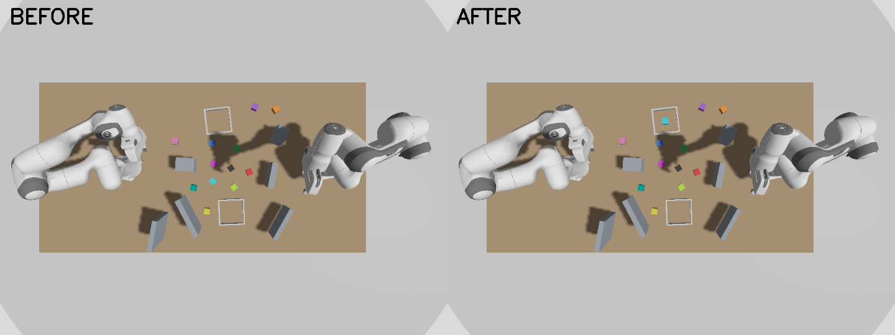

# panda_moveit

Two Franka Panda arms share a tabletop in Gazebo Harmonic, controlled through MoveIt 2 on ROS 2 Jazzy. The package includes:

- **Pick-and-place for either arm:** grasp, lift, transport and release, holding the cube with a Gazebo `DetachableJoint`.
- **A seeded scenario randomizer:** drop-off trays, 3–6 obstacles, 12 cubes and the arms' start poses. A saved scenario can be re-applied exactly.
- **Data collection:** both arms are planned on the identical scene, one executes, and the run is logged with costs, planning times, joint states and before/after RGB-D frames.

It was built for a learning project: train a model that predicts which arm should take a pick-and-place task, and compare it with planning both arms, which is the no-model baseline. [CONTEXT.md](CONTEXT.md) covers the design, conventions and known pitfalls.



## Requirements

- Ubuntu 24.04
- ROS 2 Jazzy
- Gazebo Harmonic (the version that comes with Jazzy's `ros_gz`)
- MoveIt 2

All other dependencies are listed in `package.xml` and installed by `rosdep`.

## Installation

```bash
# Clone into the src folder of a colcon workspace
mkdir -p ~/ros2_ws/src
cd ~/ros2_ws/src
git clone <repository-url> panda_moveit

# Install dependencies
cd ~/ros2_ws
source /opt/ros/jazzy/setup.bash
sudo rosdep init   # only the first time rosdep is used on this machine
rosdep update
rosdep install --from-paths src --ignore-src -y

# Build
colcon build --packages-select panda_moveit --symlink-install
source install/setup.bash
```

Use `--symlink-install`. It lets edits to configs, worlds and scripts take effect without a rebuild. The scripts also expect to run from the source folder.

## Launch the simulation

```bash
export ROS_AUTOMATIC_DISCOVERY_RANGE=LOCALHOST
export GZ_IP=127.0.0.1
cd ~/ros2_ws
source install/setup.bash
ros2 launch panda_moveit panda_moveit.launch.py
```

The two `export` lines keep ROS 2 and Gazebo traffic on this machine. Without them, discovery goes over the network, and a Wi-Fi drop during a long run makes MoveIt and controller requests time out. Set them in **every** terminal (the launch and each script), or the scripts won't find the simulation. Adding them to `~/.bashrc` is easiest; remove them if you later need ROS to talk to another computer.

This one command starts:
- Gazebo with the table world
- both arms, each with its own `ros2_control` controllers
- MoveIt's `move_group` and RViz
- the helper nodes: joint-state merger, trajectory adapter and planning-scene setup

Wait until both arms are in their `ready` pose and RViz shows the planning scene before running any script.

Keep the launch running in its own terminal. Run every command below from another terminal, from the workspace root, after `source install/setup.bash`.

## Pick and place

```bash
# Plan only (nothing moves); prints each stage and writes /tmp/panda_pick_place_<arm>.json
python3 src/panda_moveit/panda_moveit/pick_place.py --arm first

# Execute in Gazebo
python3 src/panda_moveit/panda_moveit/pick_place.py --arm first --execute
python3 src/panda_moveit/panda_moveit/pick_place.py --arm second --cube cube_blue --dropoff dropoff_a --execute
```

| Option | Meaning |
|---|---|
| `--arm first\|second` | Which Panda to use. Panda 1 sits at x = 0.2, Panda 2 at x = 1.5. |
| `--cube NAME` | Cube to pick: `cube_red`, `cube_blue`, `cube_green`, `cube_yellow`, `cube_purple`, `cube_orange`, `cube_cyan`, `cube_pink`, `cube_black`, `cube_lime`, `cube_teal` or `cube_magenta`. |
| `--dropoff dropoff_a\|dropoff_b` | Tray to place the cube in. Positions are read live from Gazebo. |
| `--place X Y` | Place at a world XY position instead of a tray. |
| `--speed`, `--accel` | Fraction of the joint velocity and acceleration limits. Default 0.5. |
| `--reset` | First return the cube to its starting position in the world file. |

## Randomize the scene

```bash
python3 src/panda_moveit/panda_moveit/scenario.py --seed 7                         # generate, apply, save to /tmp/scenarios/
python3 src/panda_moveit/panda_moveit/scenario.py --file /tmp/scenarios/scenario_7.json   # re-apply exactly
python3 src/panda_moveit/panda_moveit/scenario.py --seed 7 --dry-run               # print only
```

A scenario sets:
- **Trays:** both moved to random spots that both arms can reach.
- **Obstacles:** 3–6 walls and blocks.
- **Cubes:** all 12, each reachable by at least one arm, and 6 reachable by both.
- **Arm start poses:** random poses that MoveIt reports as collision-free.

The same seed always gives the same scenario.

## Collecting demonstrations

`demonstrations.py` runs a batch of scenarios unattended. Each scenario goes through these steps:

1. Randomize the table, then capture the **before** RGB-D frame and the joint states.
2. Choose a task (a cube and a tray) that at least one arm can complete.
3. Plan the full pick-and-place with **both** arms, 3 plans each, recording the cost and MoveIt planning time of every attempt.
4. **Execute** with the arm whose plan has the lower cost, then move it back to its start pose.
5. Capture the **after** frame, joint states and the final pose of every cube, and write it all to disk.

### Steps

1. Start the simulation in terminal 1 (see [Launch the simulation](#launch-the-simulation)) and wait for the `ready` pose.
2. In terminal 2:
   ```bash
   cd ~/ros2_ws
   source install/setup.bash
   python3 src/panda_moveit/panda_moveit/demonstrations.py --count 10
   ```
3. Leave it running; nothing needs to be typed. The output looks like this:
   ```text
   Randomizing pieces
   Running Scenario 1...
   Completed Scenario 1...
       cube_cyan -> dropoff_a, 6 obstacles | cost first 9.90, second 8.87 | second arm completed it
   Write data for scenario 1 to file for demonstration
   Randomizing pieces
   Running Scenario 2...
   ...
   Done: 10/10 scenarios completed. Data in .../panda_moveit/data
   ```
   A scenario takes about 15–20 s. If a scenario fails, the error is logged and the run continues with the next one.

| Option | Default | Meaning |
|---|---|---|
| `--count N` | 10 | Number of scenarios. |
| `--seed-start S` | random | Seeds are S, S+1, …, so the same command reproduces the same scenes. |
| `--repeats R` | 3 | Plans per arm per task. OMPL is random, so the cost label is the best of R. |
| `--out DIR` | `panda_moveit/data` | Output folder. |
| `--speed`, `--accel` | 0.5 | Keep these fixed within one dataset, since trajectory times depend on them. |

### Output

```text
data/
├── camera.json                  # intrinsics (K) and world pose of the overhead camera
├── demonstrations.jsonl         # one summary line per scenario
└── scenario_001_seed137485/
    ├── before_rgb.png           # 960x720 RGB, before the task
    ├── before_depth.npz         # float32 depth in metres, key 'depth' (np.load(f)['depth'])
    ├── after_rgb.png
    ├── after_depth.npz
    └── record.json              # everything else (see below)
```

`record.json` contains:

| Key | Contents |
|---|---|
| `scenario` | Trays, obstacles (size, pose), all 12 cube poses, both arms' start joints. |
| `task` | Cube and its pose, drop-off tray and its pose, place target. |
| `arms.first`, `arms.second` | Every planned attempt: success, failed stage, cost, total time `T`, joint path length `L`, MoveIt planning time, wall time, stage-by-stage results with joint trajectories. Also feasibility, `best_plan_index` and best cost. |
| `planner_assignment` | Assigned arm, both costs, `baseline_decision_time` (planning both arms once: the time a learned model should beat). |
| `execution` | Executed stages and trajectories, cost, final cube pose, place error, displacement of the other cubes. |
| `completed_by` | Arm that completed the task, or `null` if execution failed. |
| `joint_states` | Both arms' joint positions before and after. |
| `cube_poses_before` / `cube_poses_after` | Live poses of every cube from Gazebo. |
| `rejected_tasks` | Tasks skipped because neither arm could do them. |
| `planner`, `cost_definition`, `speed`, `accel` | MoveIt settings used for every plan (planner, time limit, attempts, tolerances), the cost formula, and the speed scaling. |

Cost is `C = T_total + 1.0 * L_total`, where `T_total` is total trajectory time in seconds and `L_total` is total joint path length in radians, both summed over all motion stages. The separate terms are stored too, so a different weighting can be used later. More elaborate assignment schemes, such as Hungarian assignment of several tasks across both arms, can be built on the same per-arm costs.

### Large plan-only datasets (training data)

`collect.py` skips execution and only plans. That's much faster, roughly 15–20 s per scenario with 4 tasks, and is the source of training data for the generative policy and the cost module. Each arm plans each task `--repeats` times (default 3), and every plan is saved with its joint trajectories. The cheapest feasible plan (lowest `C`) is that arm's cost label.

```bash
python3 src/panda_moveit/panda_moveit/collect.py --seeds 0 2000 --out ~/panda_data
python3 src/panda_moveit/panda_moveit/collect.py --seeds 0 20 --execute --out ~/panda_data_exec
```

```text
panda_data/
├── camera.json
├── trials.jsonl                     # one summary line per (seed, task): poses, both arms' feasibility and best cost
├── trials/seed_<seed>_task_<i>.json # full record: every plan, stage by stage, with joint trajectories
├── scenarios/scenario_<seed>.json   # full scene, incl. both arms' start joints
└── images/scene_<seed>_rgb.png, scene_<seed>_depth.npz   # before any task; shared by the seed's tasks
```

2,000 seeds take about 9 hours and about 1.1 GB. To leave it running unattended and log to a file:

```bash
setsid nohup python3 -u src/panda_moveit/panda_moveit/collect.py --seeds 0 2000 --out ~/panda_data \
    > ~/panda_data_collect.log 2>&1 < /dev/null &
tail -f ~/panda_data_collect.log          # watch progress
wc -l < ~/panda_data/trials.jsonl         # trials saved so far (4 per seed)
pkill -f collect.py                       # stop
```

It can resume: seeds already in `trials.jsonl` are skipped, so rerunning the same command after an interruption continues where it stopped. A seed is written only once all its tasks are done.

Failures during a long run:
- A camera frame that doesn't arrive is retried up to 3 times.
- A seed that fails is retried once, then skipped. A rerun of the same command tries skipped seeds again.
- The run stops by itself if 5 seeds in a row fail, or if an arm gets stuck in Gazebo (see [Troubleshooting](#troubleshooting)). Restart the launch, then rerun the same command.

**Seeds and reproducibility.** A seed fixes the scene, the arm start poses and the 4 tasks, on any machine. It does not fix the plans: OMPL is random, so trajectories and costs differ between runs, and planning times depend on the CPU.

**Collecting on several PCs.** Give each PC its own seed range so every scene is new, then merge the output folders (file names include the seed, so nothing collides):

| PC | Command |
|---|---|
| 1 | `collect.py --seeds 0 2000 --out ~/panda_data` (seeds 0–1999) |
| 2 | `collect.py --seeds 2000 2000 --out ~/panda_data` (seeds 2000–3999) |
| 3 | `collect.py --seeds 4000 2000 --out ~/panda_data` (seeds 4000–5999) |

Use `--seeds 2000 1000` etc. for 1,000 seeds; keep the starting points so the ranges never overlap. Running the same range on two PCs gives the same scenes with different plans, not new scenes. Keep `--repeats`, `--speed` and `--accel` the same everywhere. Compare planning times only within one machine.

**Split train/validation/test by seed, never by task.** A seed's tasks share one scene and image, so splitting them would let the model see test scenes during training. Our split: seeds 1700–1849 validation and 1850–1999 test, every other seed (0–1699 and all seeds from other PCs) for training.

## Converting to a LeRobot dataset

`convert_lerobot.py` turns `collect.py` output into LeRobot datasets for Diffusion Policy. It runs in its own Python environment, not the ROS one:

```bash
python3 -m venv ~/lerobot_venv
~/lerobot_venv/bin/pip install "lerobot[dataset,training,diffusion]==0.6.1"

~/lerobot_venv/bin/python src/panda_moveit/panda_moveit/convert_lerobot.py --data ~/panda_data --out ~/lerobot_data --height-map
```

Run it after collection has finished: it uses all CPU cores, which would slow MoveIt and inflate the planning times being recorded. With `--height-map` it takes about 2–3 h for 2,000 seeds.

- **Episode:** one arm's best feasible plan for one task, resampled to 5 Hz (`--fps`). Infeasible (trial, arm) pairs are listed in `infeasible.jsonl` instead.
- **One shared model for both arms:** every input is in the acting arm's base frame, the image is rotated 180° for the second arm (the camera is above the midpoint between the bases, so this puts the second arm where the first one is), and the arm ID is the last two numbers of `observation.environment_state`. `--arms first` builds a single-arm dataset instead.
- **Splits:** `train/`, `val/` (seeds 1700–1849) and `test/` (seeds 1850–1999), each a LeRobot dataset, with `<split>_episodes.jsonl` mapping each episode to its seed, task, arm and MoveIt cost.

| Feature | Shape | Contents |
|---|---|---|
| `observation.state` | 8 | 7 joint angles + gripper width (0.04 open, 0.015 closed) |
| `observation.environment_state` | 71 | target cube, place target, both trays, 6 obstacle slots (nearest first, with a present flag), the other arm's joints, arm ID; names in `conversion.json` |
| `observation.images.overhead` | 240×320×3 | the before RGB image, repeated on every frame (video) |
| `observation.images.height` | 240×320×3 | with `--height-map` only: height above the table from depth, 0–0.35 m (images, not video) |
| `action` | 8 | joint angles + gripper width at the next frame |

Train (one checkpoint per `--save_freq` steps under `--output_dir`):

```bash
~/lerobot_venv/bin/lerobot-train --policy.type=diffusion \
    --dataset.repo_id=dual_panda_train --dataset.root=$HOME/lerobot_data/train \
    --policy.n_obs_steps=1 --policy.horizon=32 --policy.n_action_steps=32 --policy.drop_n_last_frames=0 \
    --policy.noise_scheduler_type=DDIM --policy.num_inference_steps=10 --policy.down_dims='[256,512,1024]' \
    --policy.use_separate_rgb_encoder_per_camera=true --policy.push_to_hub=false \
    --batch_size=64 --steps=100000 --save_freq=10000 --num_workers=8 \
    --wandb.enable=false --output_dir=outputs/diffusion_dual_panda
```

`drop_n_last_frames=0` matters: the default (7) never starts a training chunk in an episode's last 7 frames, which hides most of the lower and retreat stages in these ~24-frame episodes. `down_dims='[256,512,1024]'` is a smaller U-Net (88M parameters instead of 276M): the 32×8 action chunks don't need the default, and it samples ~3× faster. With the height map in the dataset, the policy uses it as a second camera with its own encoder. Lower `--batch_size` on smaller GPUs (16 fits in 8 GB).

## Evaluating a trained policy

`evaluate_policy.py` samples K trajectories per arm for each trial in a seed range, scores them, and compares the resulting arm choice with MoveIt's:

```bash
~/lerobot_venv/bin/python src/panda_moveit/panda_moveit/evaluate_policy.py \
    --checkpoint outputs/diffusion_dual_panda/checkpoints/last/pretrained_model \
    --seeds 1700 1850 --samples 16 --out ~/eval_val.jsonl
```

- **A sample is valid** if the gripper closes within 3 cm of the cube, opens within 3 cm of the place target, and the approximate collision check (`collision_check.py`) finds no contact. Its cost is `T + 1.0 * L`, computed like MoveIt's.
- **Assignment:** the arm with the cheapest valid sample, compared with MoveIt's cheapest arm. The summary prints agreement, regret (extra MoveIt cost of the chosen arm), wrong-feasibility counts, sample validity, grasp/place error and decision time.
- **Checked against MoveIt's own plans** as perfect samples: 98.9% valid (the rest are the collision check's 1.1% false positives), median grasp error 4 mm, cost within ~0.04.
- **Speed:** both arms' samples are denoised in one batch, each arm's image is encoded once, and sampling runs in bf16 (`--no-bf16` to disable). On an RTX 4060, one chunk for 2 arms × 16 samples takes ~205 ms with the default U-Net and ~70 ms with `--policy.down_dims='[256,512,1024]'`.

Other tools: `plot_trajectories.py` draws TCP paths over the scene image, `data_stats.py` summarizes a dataset, `panda_kinematics.py` is numpy forward kinematics.

## Viewing the camera in Gazebo

1. In the Gazebo window, click the **⋮** menu in the top-right corner.
2. Search for **Image Display** and open it.
3. Refresh the topic list, then choose `/overhead_camera/image` (color) or `/overhead_camera/depth_image` (depth).

The camera topics exist only in Gazebo. To see them in RViz or `rqt_image_view`, add a `ros_gz_bridge` image bridge.

## Package layout

| Path | Purpose |
|---|---|
| `launch/panda_moveit.launch.py` | Starts everything: Gazebo, both arms, controllers, MoveIt, RViz, helper nodes. |
| `worlds/panda_world.sdf` | Table, 12 cubes, 2 drop-off trays, starting wall, overhead RGB-D camera. |
| `config/urdf/panda.urdf.xacro` | Single Panda for Gazebo (both arms are spawned from it). |
| `config/urdf/dual_panda.urdf` | Combined MoveIt model with `first_` and `second_` prefixes. Generated by `create_dual_panda.py`. |
| `config/dual_panda.srdf` | MoveIt groups: `first_panda_arm`, `second_panda_arm`, `both_panda_arms`, hands. |
| `config/ros2_controllers*.yaml` | Per-arm `ros2_control` controllers, including goal tolerances. |
| `config/dual_moveit_controllers.yaml`, `config/dual_kinematics.yaml` | MoveIt controller mapping and KDL kinematics. |
| `panda_moveit/pick_place.py` | Pick-and-place pipeline, gripper control, Gazebo and planning-scene helpers. |
| `panda_moveit/scenario.py` | Scenario generator and applier. |
| `panda_moveit/demonstrations.py` | Unattended plan-both-execute-best demonstrations. |
| `panda_moveit/collect.py` | Plan-only paired-trial collector; also the camera capture code. |
| `panda_moveit/convert_lerobot.py` | Converts collected plans to LeRobot datasets (run with the LeRobot venv). |
| `panda_moveit/evaluate_policy.py` | Samples a trained policy on held-out seeds and compares with MoveIt. |
| `panda_moveit/collision_check.py`, `panda_kinematics.py` | Fast approximate collision check and forward kinematics for generated trajectories. |
| `panda_moveit/plot_trajectories.py`, `data_stats.py` | Trajectory plots over the scene image; dataset statistics. |
| `panda_moveit/dual_joint_states.py` | Merges both arms' joint states into `/dual_joint_states` with prefixed names. |
| `panda_moveit/dual_trajectory_adapter.py` | Forwards MoveIt trajectories to each arm's Gazebo controller. |
| `panda_moveit/planning_scene_setup.py` | Loads the table, cubes, trays and obstacles from the world into MoveIt at startup. |
| `create_dual_panda.py` | Regenerates `dual_panda.urdf` from the xacro. Run it from the package root. |
| `panda_moveit/panda_controller.py`, `panda_moveit/move_panda.py`, `test_trajectory.py` | Early single-arm experiments, kept for reference. |

## Troubleshooting

- **`MoveIt request timed out` / `/move_action unavailable`:** the launch isn't fully up yet. Wait for the `ready` pose and RViz's planning scene. If it happens mid-run, check that the launch and the script use the same `export` lines from [Launch the simulation](#launch-the-simulation).
- **`Exception sending a multicast message: Network is unreachable` in the log:** the network dropped and discovery went with it. Restart with the localhost `export` lines.
- **`arm is stuck in Gazebo (joint at a hard limit)`:** Gazebo occasionally locks a joint at its limit, and nothing short of a restart frees it. Restart the launch and rerun the collector; it resumes.
- **A stage fails with a goal tolerance error:** the arm couldn't follow the trajectory at the requested speed. Try `--speed 0.3`.
- **`stopped while holding the cube`:** a run stopped mid-task. Applying any scenario releases every cube and resets the table. `pick_place.py --cube <name> --reset` releases just that cube.
- **Changes to the world or controller configs have no effect:** Gazebo and the controllers only read them at launch. Restart the launch.
